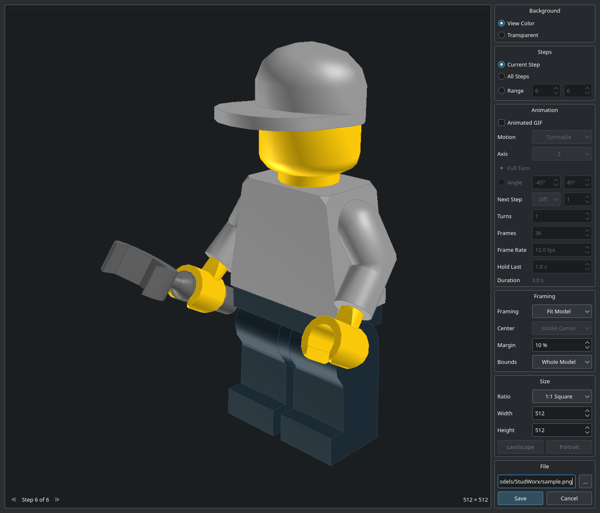
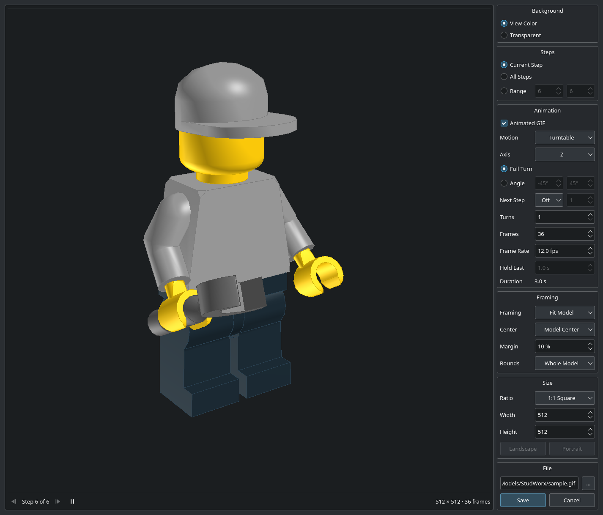
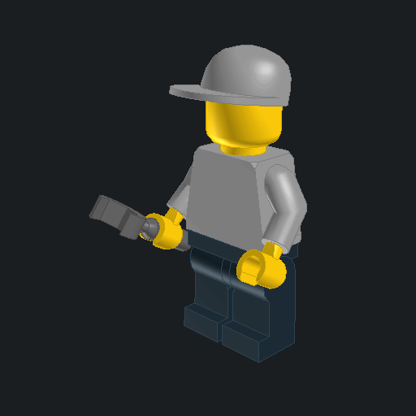
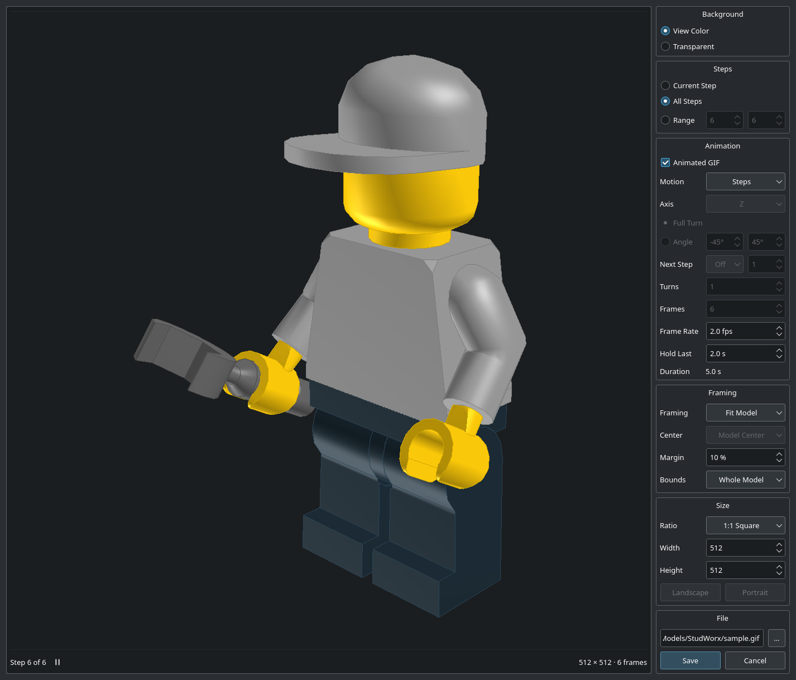
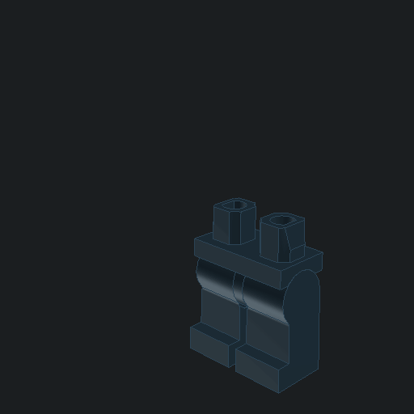
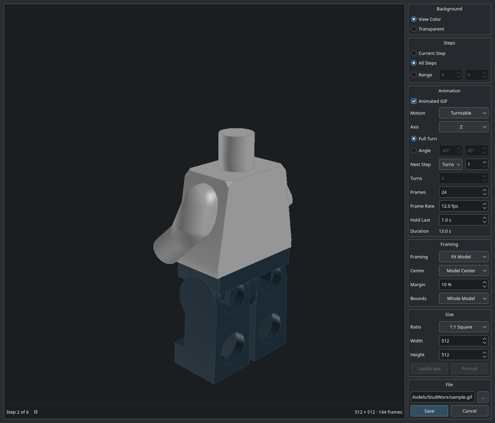
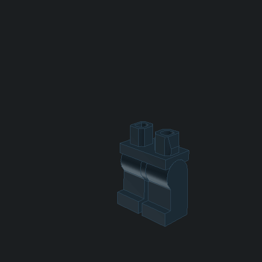

# Save Model Image

File > Image saves still images and animated GIFs of the active model. The
preview on the left shows exactly what will be saved, and the settings on the
right are grouped by what they change. Every setting is kept for the next time
the dialog opens, and the What's This button in the title bar or F1 on a focused
control explains each one.

## Still images

### Background

- **View Color** fills the background with the model view background and saves
  it opaque.
- **Transparent** leaves the background empty so the model can be placed over
  other images. Only PNG and GIF files keep transparency, and GIF edges are hard,
  without smoothing.

### Steps

- **Current Step** saves only the step shown in the model view.
- **All Steps** saves every step of the active model.
- **Range** saves the steps from the first to the last field, both included.

Saving several still steps writes one numbered file per step, with the step
number before the extension: `model.png` becomes `model01.png`, `model02.png`
and so on. The arrows under the preview look through the steps before saving.

### Framing

- **Framing**
  - **Current View** saves exactly what the model view shows.
  - **Fit Model** aims at the model and moves the camera back until every part
    fits inside the image, at every turntable angle.
  - **Fit Each Step** fits every step on its own parts.
- **Center** is the point the camera aims at and the turntable turns around:
  **World Origin** (0, 0, 0), **Model Origin** (the middle of the model base) or
  **Model Center** (the middle of the model). It is used by turntables only.
- **Margin** keeps empty space around the model, from 0 to 50 percent of the
  image.
- **Bounds** measures the fit and center on the **Whole Model**, so every step
  lines up, or on the **Shown Steps** only.

### Size

- **Ratio** links width and height: **Free** unlinks them, **View** follows the
  shape of the model view, and the presets go from **1:1 Square**, the default,
  through 5:4, 4:3, 3:2 and 16:10 to 16:9 and 21:9.
- **Width** and **Height** are in pixels, from 1 to 32768.
- **Landscape** and **Portrait** turn the image on its side.

### File

Type the path or choose it with the **...** button. The extension sets the
format: `.png`, `.jpg`, `.bmp`, or `.gif` for animations. Turning Animated GIF on
or off switches the extension for you.

## Animated GIF

Check **Animated GIF** in the Animation group to save one looping GIF. The
preview plays the animation live, with a play and pause button under it, and
the frame count shows beside the image size. **Motion** chooses what moves.

| Setting | Turntable | Steps |
|---|---|---|
| Axis, Full Turn, Angle | used | off |
| Next Step | Off, Turns or Seconds | off |
| Turns | revolutions or swings per loop | off |
| Frames | per turn, 2 to 360 | one per step, read only |
| Frame Rate | 0.5 to 50 fps | 0.5 to 50 fps |
| Hold Last | with Next Step on | used |
| Duration | read only | read only |

### Turntable

The model turns around one axis through the Framing center, starting from the
current view.

- **Axis** is X, Y or Z.
- **Full Turn** makes seamless revolutions. **Angle** swings from the first to
  the second angle, measured from the current view, and back again.
- **Turns** sets how many revolutions or swings make up one loop, from 1 to 10,
  so complex builds can be shown from every side more than once.
- **Frames** is the number of images in one turn. More frames turn more
  smoothly and make a larger file.
- **Frame Rate** is the number of frames shown each second.
- **Duration** shows how long one loop plays: turns × frames ÷ frame rate.

Fit Model keeps one steady zoom through the whole turn, so the model turns in
place without the camera moving in and out.

### Steps

Each step chosen in the Steps group becomes one frame, without turning, for
short animated instructions. Frames shows the step count and the turntable
settings are off.

- **Frame Rate** sets how fast the steps follow each other. 2 fps shows each
  step for half a second.
- **Hold Last** keeps the finished model on screen before the loop restarts,
  from 0 to 10 seconds.
- **Duration** is steps ÷ frame rate + hold.

### Next Step

Next Step combines both: the model keeps turning while the build moves on one
step at a time, through the steps chosen in the Steps group. The loop ends on
the last step and starts again.

- **Next Step** moves on every few **Turns** (1 to 10) or every few
  **Seconds** (0.1 to 60), set in the field beside it. **Off** turns the model
  without stepping.
- **Turns** becomes read only and shows the total: steps × turns per step.
- **Frames** stays per turn, so the turning speed is the same however many steps
  there are.
- **Hold Last** keeps the finished model on screen before the loop restarts.
- **Duration** is the frames of every step ÷ frame rate + hold.

The example above shows six steps, one turn each, at 24 frames per turn and
12 fps, with a one second hold: 144 frames playing for 13 seconds.

## Settings

The dialog keeps its settings in the `[Settings]` group of
`~/.config/StudWorx/StudWorx.conf`, saved when you click Save:

| Key | Setting |
|---|---|
| `ImageWidth`, `ImageHeight`, `ImageRatio` | Size |
| `ImageExtension` | File format |
| `ImageSteps`, `ImageTransparent` | Steps and Background |
| `ImageMotion`, `ImageAxis`, `ImageFullTurn`, `ImageAngleStart`, `ImageAngleEnd` | Motion and turn |
| `ImageTurns`, `ImageFrames`, `ImageFrameRate` | Turns, Frames, Frame Rate |
| `ImageNextStep`, `ImageNextStepTurns`, `ImageNextStepSeconds` | Next Step |
| `ImageHoldLast` | Hold Last |
| `ImageFit`, `ImageCenter`, `ImageMargin`, `ImageFitScope` | Framing |

## Command line

Still images can also be saved without opening a window, with `--image` and
the options listed in `man studworx`, including `--transparent` for an empty
background. Animations are saved from the dialog.
